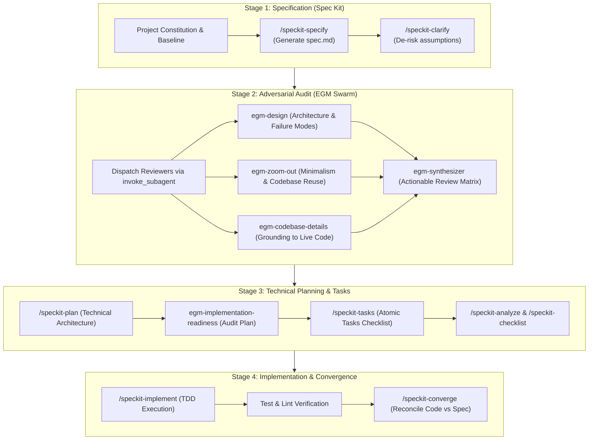

# Oh My Anti (OMA) 🚀

> Unified Spec-Driven Development (Spec Kit) & Adversarial Multi-Agent Review (EGM) Pipeline for Antigravity.

Oh My Anti is an end-to-end engineering suite designed for Google Antigravity and AI coding agents. It orchestrates the full lifecycle of feature development: from natural language requirements, through formal specification, adversarial multi-agent review, technical planning, and task breakdown, to final implementation and verification.

---

## ⚡ Architecture & Pipeline



---

## 📦 What's Included

1. **End-to-End Orchestrator**:
   * `/speckit-egm`: Single autonomous command running the entire 4-stage pipeline from prompt to verified code.
2. **Spec Kit (SDD)**:
   * `/speckit-constitution`: Non-negotiable project architecture principles.
   * `/speckit-specify`: Structured feature specifications.
   * `/speckit-clarify`: Interactive clarification of ambiguous points.
   * `/speckit-plan`: Technical design and API contracts.
   * `/speckit-tasks`: Granular, dependency-ordered tasks.
   * `/speckit-implement`: Phased TDD task implementation.
   * `/speckit-converge`: Verification and codebase reconciliation.
3. **EGM Review Personas**:
   * 10 fresh-context subagent reviewer prompts (`zoom_out`, `design_critic`, `codebase_details`, `synthesizer`, etc.).
   * Document standards for Heilmeier criteria and implementation readiness.
4. **Natural Language Intent Classifier**:
   * Pre-configured `AGENTS.md` rules with bilingual (Vietnamese/English) automatic intent detection.

---

## 🛠️ Quick Installation

### Windows (PowerShell)
```powershell
git clone https://github.com/Royal2005-coder/oh-my-anti.git
cd oh-my-anti
.\install.ps1
```

### macOS / Linux
```bash
git clone https://github.com/Royal2005-coder/oh-my-anti.git
cd oh-my-anti
chmod +x install.sh
./install.sh
```

---

## 📄 License
MIT License. Open-source and free for community use.
