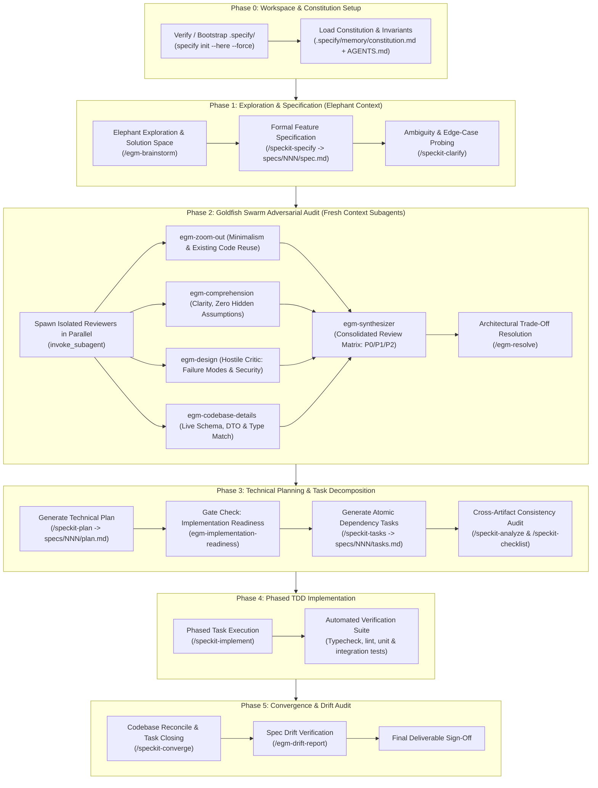

# `egm-speckit` Master Orchestrator: Full-Cycle Spec & Adversarial Engineering

This skill is the **complete, end-to-end autonomous engineering pipeline** uniting the dual superpowers of:
1. **GitHub Spec Kit (SDD)**: Rigorous specification, clarification, technical planning, atomic task decomposition, and verifiable convergence.
2. **Google Elephant-Goldfish Model (EGM)**: Deep repository context (Elephant) combined with unbiased adversarial review by fresh-context, isolated subagents (Goldfish Swarm).

When triggered via `/egm-speckit <feature / refactor / requirement>`, the agent executes all 5 phases sequentially to final sign-off without taking shortcuts.

---

## 🔁 Complete Lifecycle Architecture



---

## 📋 Step-by-Step Execution Protocol

### Phase 0: Workspace & Constitution Setup
1. **Check Infrastructure**:
   - Check if `.specify/` exists in project root. If missing, automatically initialize:
     ```powershell
     specify init --here --force --integration agy --non-interactive --script ps
     ```
2. **Review Constitution**:
   - Read `.specify/memory/constitution.md` and repository rules in `AGENTS.md`.
   - Extract non-negotiable architectural constraints (e.g. state management patterns, strict typing, forbidden libraries, security policies).

### Phase 1: Exploration & Specification Drafting
1. **Elephant Brainstorming (`/egm-brainstorm`)**:
   - Survey the problem space with deep codebase context. Formulate 2-3 design alternatives and choose the cleanest one based on project invariants.
2. **Draft Baseline Specification (`/speckit-specify`)**:
   - Create `specs/NNN-<feature-name>/spec.md` following standard templates.
   - Detail User Stories, Functional Requirements, Non-Functional Requirements, Input/Output boundaries, and Acceptance Criteria.
3. **Clarify Ambiguities (`/speckit-clarify`)**:
   - Probe for unstated assumptions, missing edge cases (network failure, race conditions, empty data, authorization limits) and update `spec.md`.

### Phase 2: Goldfish Swarm Adversarial Audit
> [!IMPORTANT]
> Goldfish subagents **MUST** run in fresh, isolated contexts using `invoke_subagent`. They examine the drafted `spec.md` without conversation history bias.

1. **Dispatch Parallel Reviewers**:
   - **`egm-zoom-out`**: Challenges over-engineering, enforces YAGNI, identifies existing helpers/services in the codebase that should be reused.
   - **`egm-comprehension`**: Naive reader review. Flags unclear terms, missing definitions, and comprehension barriers.
   - **`egm-design`**: Adversarial review. Hunts for single-points-of-failure, scalability bottlenecks, race conditions, and security attack vectors.
   - **`egm-codebase-details`**: Verifies referenced files, model names, schema columns, and API contracts against actual code.
2. **Synthesize & Resolve (`egm-synthesizer` & `/egm-resolve`)**:
   - Deduplicate findings into a **Review Matrix**:
     * **P0 Blockers**: Must be fixed in `spec.md` immediately before planning.
     * **P1 Majors**: Must be specifically addressed in `plan.md`.
     * **P2 Minors**: Polish and maintainability items.
   - Apply resolutions to `spec.md`.

### Phase 3: Technical Planning & Task Breakdown
1. **Draft Technical Plan (`/speckit-plan`)**:
   - Generate `specs/NNN-<feature-name>/plan.md` integrating all resolved EGM findings.
   - Detail data structures, interfaces/DTOs, component boundaries, state flow, and error-handling strategies.
2. **Implementation Readiness Gate (`egm-implementation-readiness`)**:
   - Review `plan.md` to guarantee it leaves **zero architectural decisions** to the implementer. All contracts must be concrete.
3. **Atomic Task Breakdown (`/speckit-tasks`)**:
   - Generate `specs/NNN-<feature-name>/tasks.md` with ordered, independent, atomic checklist tasks tagged by phase (e.g., Phase 1: Models & Stores, Phase 2: Services & Logic, Phase 3: UI & Wiring, Phase 4: Verification).
4. **Consistency Audit (`/speckit-analyze` & `/speckit-checklist`)**:
   - Cross-check traceability: Every requirement in `spec.md` maps to tasks in `tasks.md`. Generate acceptance criteria checklists.

### Phase 4: Phased TDD Implementation
1. **Execute Tasks (`/speckit-implement`)**:
   - Implement tasks sequentially following TDD: write test $\rightarrow$ implement code $\rightarrow$ verify green.
   - Adhere strictly to project conventions: strict TypeScript, Signals/Observables, clean architecture, no `any`, proper JSDoc.
2. **Automated Verification**:
   - Run typecheck, linter, unit tests, and integration tests after each phase.

### Phase 5: Convergence & Drift Audit
1. **Reconcile & Close (`/speckit-converge`)**:
   - Scan codebase to confirm 100% of tasks in `tasks.md` are completed. Reconcile any unexpected edge cases.
2. **Spec Drift Report (`/egm-drift-report`)**:
   - Audit actual implementation against `spec.md` and `plan.md`. Ensure zero unintended deviation or scope creep occurred.
3. **Final Sign-off**:
   - Deliver summary with file links, test results, and verified acceptance criteria to the user.
