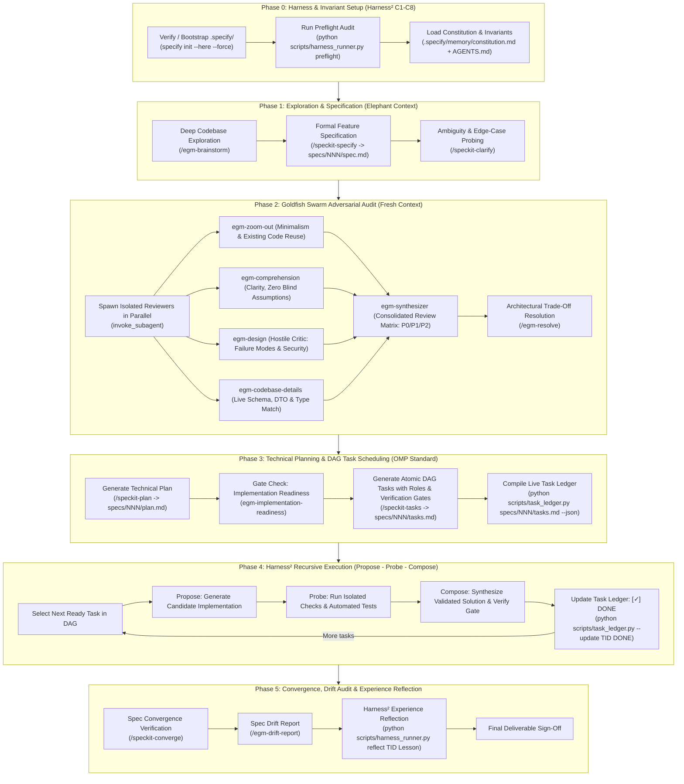

# `egm-speckit` Master Orchestrator: Full-Cycle Autonomous Harness

`egm-speckit` is an **enterprise-grade autonomous engineering harness** combining three breakthrough systems:
1. **Google Research Harness²**: The 8-component architecture (Prompt, Guardrails, Memory, Tools, Subagents, Skills, Scripts, Plugins), task-level recursion (**Propose – Probe – Compose**), and persistent experience reflection.
2. **GitHub Spec Kit (SDD)**: Rigorous specification, ambiguity clarification, technical architecture planning, and verifiable convergence.
3. **Google Elephant-Goldfish Model (EGM)**: Deep repository memory (Elephant) combined with unbiased adversarial review by fresh-context, isolated subagents (Goldfish Swarm).
4. **Oh-My-Pi (OMP) Parity**: Real-time interactive Task Ledger DAG tracking, phase grouping, and visual progress monitoring.

When triggered via `/egm-speckit <task>` or `/egm <task>`, the agent executes the complete 5-phase pipeline autonomously.

---

## 🔁 Complete Autonomous Architecture



---

## 📋 Step-by-Step Execution Protocol

### Phase 0: Harness & Invariant Setup
1. **Preflight Audit**:
   - Run `python scripts/harness_runner.py preflight` to ensure all 8 harness components (Prompt, Guardrails, Memory, Tools, Subagents, Skills, Scripts, Plugins) are active.
2. **Infrastructure**:
   - Verify `.specify/` exists. If missing, initialize:
     ```powershell
     specify init --here --force --integration agy --non-interactive --script ps
     ```
3. **Constitution & Invariants**:
   - Extract non-negotiable architectural rules from `AGENTS.md` and `.specify/memory/constitution.md`.

### Phase 1: Exploration & Specification
1. **Elephant Brainstorming (`/egm-brainstorm`)**:
   - Explore repository context, dependencies, and previous lessons learned. Formulate concrete architectures.
2. **Draft Baseline Specification (`/speckit-specify`)**:
   - Generate `specs/NNN-<feature>/spec.md` with User Stories, inputs/outputs, non-functional requirements, and acceptance criteria.
3. **Clarify Ambiguities (`/speckit-clarify`)**:
   - Probe edge cases: network timeout, null state, authorization boundary, race conditions.

### Phase 2: Goldfish Swarm Adversarial Audit
> [!IMPORTANT]
> Goldfish subagents **MUST** execute in fresh, isolated contexts using `invoke_subagent`. They audit the drafted `spec.md` without conversation bias.
1. Dispatch parallel personas: `egm-zoom-out`, `egm-comprehension`, `egm-design`, `egm-codebase-details`.
2. Compile Review Matrix via `egm-synthesizer` and resolve critical findings via `/egm-resolve`.

### Phase 3: Technical Planning & DAG Task Scheduling
1. **Technical Architecture Plan (`/speckit-plan`)**:
   - Create `specs/NNN-<feature>/plan.md` defining models, services, DTOs, state flow, and error handling.
2. **Implementation Readiness Gate (`egm-implementation-readiness`)**:
   - Ensure zero architectural ambiguity is left for the implementer.
3. **DAG Task Breakdown (`/speckit-tasks`)**:
   - Generate `specs/NNN-<feature>/tasks.md` in **OMP-Format**:
     - `[ID]` e.g. `[T01]`
     - `[Role: subagent-frontend | backend | architect]`
     - `[Depends on: T01]`
     - `[Verify: npm run test ...]`
4. **Initialize Task Ledger**:
   - Run `python scripts/task_ledger.py specs/NNN/tasks.md --json .specify/memory/tasks_ledger.json` to enable live statusline tracking.

### Phase 4: Harness² Recursive Execution (Propose – Probe – Compose)
For each atomic task in the DAG:
1. Mark task `IN_PROGRESS` in Task Ledger.
2. **Propose**: Generate candidate implementation diff.
3. **Probe**: Run automated tests, typechecks, or subagent review.
4. **Compose & Verify**: Integrate verified code and execute the task's verification gate.
5. Mark task `DONE` in Task Ledger (`python scripts/task_ledger.py --update TID DONE`).

### Phase 5: Convergence, Drift Audit & Experience Reflection
1. **Spec Convergence (`/speckit-converge`)**: Verify all requirements are satisfied in code.
2. **Spec Drift Audit (`/egm-drift-report`)**: Verify zero unintended deviation occurred.
3. **Harness² Experience Reflector**:
   - Run `python scripts/harness_runner.py reflect <TID> "<lesson>"` to persist insights in `.specify/memory/lessons.md`.
4. Present final report with test results, links, and git commit details.
