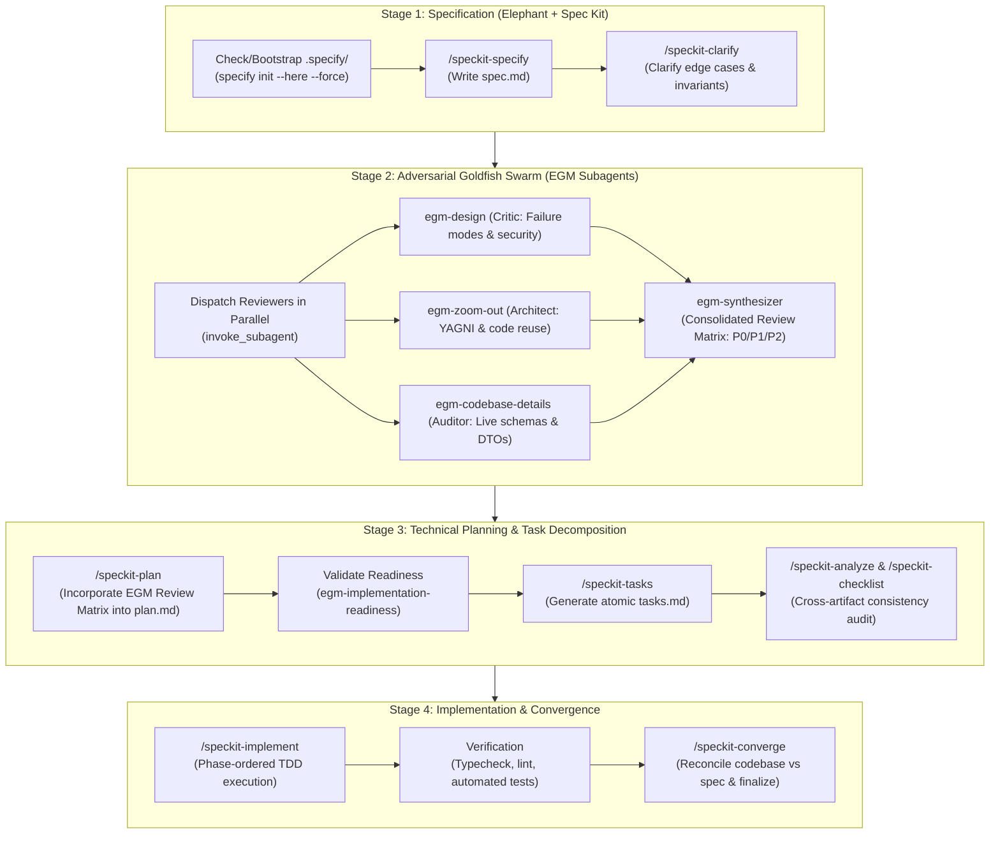

# EGM + Spec Kit Full-Cycle Unified Pipeline (`/egm-speckit`)

This skill provides a manual trigger (`/egm-speckit`) for complex feature development or major architectural refactors. It executes a complete, rigorous, closed-loop pipeline combining **Elephant-Goldfish Model (EGM)** and **GitHub Spec Kit (SDD)**.

When triggered, the agent autonomously drives the task through all 4 stages to completion without skipping validation gates.



---

## Autonomous Execution Guide

### Trigger
```text
/egm-speckit <feature description or architectural requirement>
```

### Phase 1: Specification & Clarification
1. Verify if `.specify/` exists in project root. If missing, initialize via:
   ```powershell
   specify init --here --force --integration agy --non-interactive --script ps
   ```
2. Read project constitution from `.specify/memory/constitution.md` and repository conventions from `AGENTS.md`.
3. Create the feature directory (e.g. `specs/NNN-<feature>/`) and write the baseline `spec.md` with user stories, acceptance criteria, and constraints.
4. Run clarification on any ambiguous requirements, edge cases, or unspoken assumptions using `/speckit-clarify`.

### Phase 2: Goldfish Swarm Audit (Isolated Context Subagents)
Spawn fresh-context subagents via `invoke_subagent` to independently critique the specification:
* **`egm-design`**: Analyzes failure scenarios, boundary conditions, performance bottlenecks, and security attack surfaces.
* **`egm-zoom-out`**: Challenges over-engineering, enforces YAGNI, and maps reusable components already in the codebase.
* **`egm-codebase-details`**: Verifies exact file paths, exported types, API models, and database contracts against actual code.
* **`egm-synthesizer`**: Compiles findings into an actionable Review Matrix (P0 Blockers, P1 Majors, P2 Minors).

### Phase 3: Technical Planning & Tasks Breakdown
1. Incorporate all P0/P1 findings into `/speckit-plan` and produce `specs/NNN-<feature>/plan.md`.
2. Audit plan feasibility using `egm-implementation-readiness` (ensuring no design ambiguity is left to implementers).
3. Generate granular, atomic tasks in `specs/NNN-<feature>/tasks.md` via `/speckit-tasks`.
4. Audit cross-artifact traceability using `/speckit-analyze` and generate acceptance criteria using `/speckit-checklist`.

### Phase 4: Implementation & Convergence
1. Execute tasks in sequence using `/speckit-implement` following TDD and strict repository coding standards.
2. Run project verification suite (typecheck, lint, automated tests).
3. Execute `/speckit-converge` to verify that all requirements from `spec.md` are completely met by the implementation, closing all checklist items.
