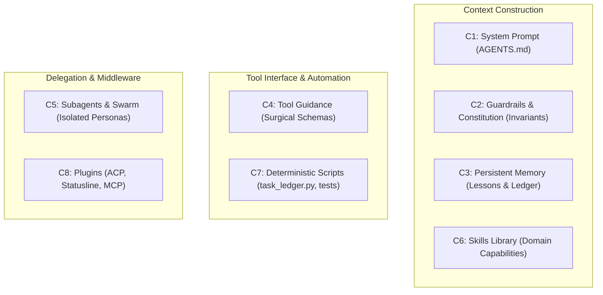

# `harness2` — Recursive Agent Harnessing Engine (Google Research)

A **harness** is the comprehensive system surrounding an AI model that enables it to operate effectively as an autonomous agent:
**System Prompts, Guardrails, Memory, Tool Guidance, Subagents, Skills, Scripts, and Plugins**.
**Harnessing** is the continuous optimization of that entire system.

`harness2` introduces **dual-level recursive harnessing** for open-world software engineering:
1. **Task-Level Recursion (Propose – Probe – Compose)**:
   Refines the execution strategy for the active task without requiring ground-truth labels.
   - **Propose**: Generate 2–3 competing implementation or refactoring hypotheses.
   - **Probe**: Dispatch isolated subagent probes or dry-run checks to observe actual behavior.
   - **Compose**: Contrast the behavioral evidence and synthesize the optimal, verified resolution.

2. **Harnessing-Level Recursion (Experience Reflection)**:
   Maintains a persistent memory ledger (`.specify/memory/lessons.md`) of proven patterns, architectural constraints, and failure modes to accelerate all future task executions.

---

## 🏛️ The 8 Editable Harness Components (C1 – C8)

---

## 🚀 CLI Commands & Sub-routines

| Command | Action |
|---|---|
| `python scripts/harness_runner.py preflight` | Audits the active workspace across all 8 harness components. |
| `python scripts/task_ledger.py specs/NNN/tasks.md` | Renders the visual OMP-style Task Orchestration Ledger. |
| `python scripts/task_ledger.py specs/NNN/tasks.md --json <out.json>` | Generates JSON task graph for statusline and subagent dispatching. |
| `python scripts/task_ledger.py specs/NNN/tasks.md --update <ID> <STATUS>` | Updates task state (`TODO`, `IN_PROGRESS`, `DONE`, `BLOCKED`, `FAILED`). |
| `python scripts/harness_runner.py reflect <ID> <lesson>` | Commits learned insight to persistent memory (`.specify/memory/lessons.md`). |

---

## 🔄 Recursive Execution Workflow for Any Task

When executing an atomic task $T_i$ from `tasks.md`:
1. **Check Prerequisites**: Ensure all tasks in `[Depends on: ...]` are marked `DONE`.
2. **Propose**: Formulate candidate diff or test case.
3. **Probe**: Run typecheck, unit tests, or launch an `invoke_subagent` probe.
4. **Compose & Verify**: If probe passes verification gate (`[Verify: ...]`), commit change.
5. **Update Ledger & Reflect**: Run `task_ledger.py --update <ID> DONE` and record any non-obvious lessons.
