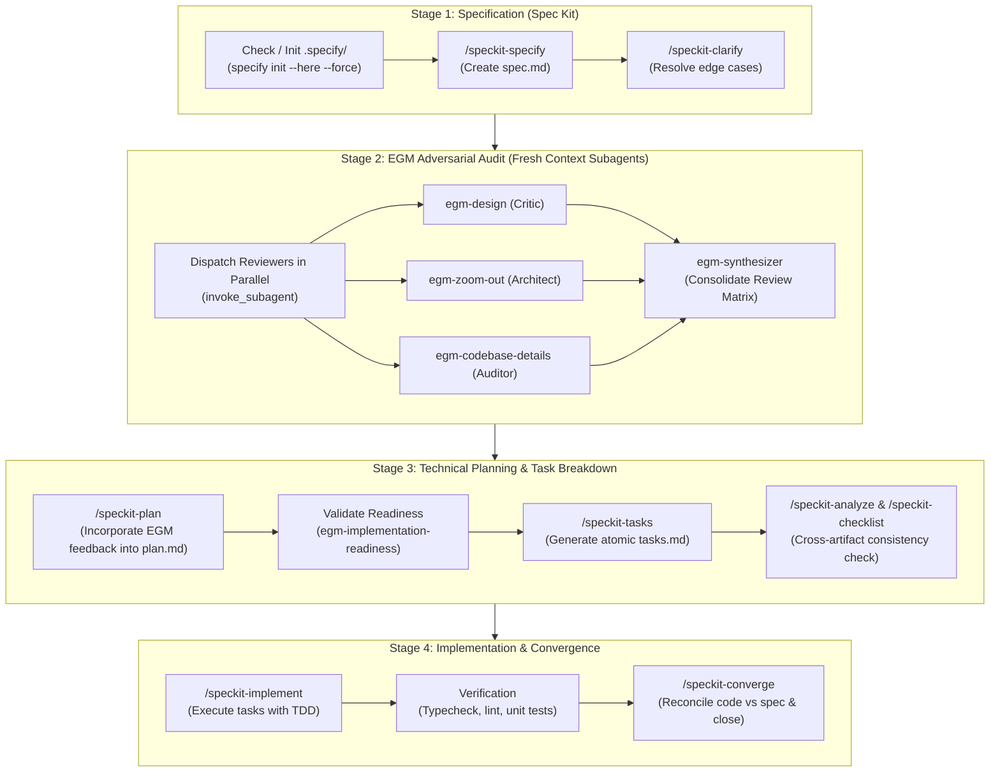

# Unified Spec Kit + EGM Engineering Pipeline (End-to-End Orchestrator)

Execute a complete end-to-end engineering cycle combining **GitHub Spec Kit** (for rigorous specification, planning, and task tracking) and **Google Elephant-Goldfish Model (EGM)** (for independent adversarial multi-agent review via isolated subagents).

When invoked, the agent autonomously drives the feature or architectural change through all 4 stages to final convergence without skipping quality gates.



---

## Autonomous Execution Protocol

### Step 0: Environment & Workspace Check
1. Check if `.specify/` exists in the project root.
   - If not, automatically run:
     ```powershell
     specify init --here --force --integration agy --non-interactive --script ps
     ```
2. Read project principles from `.specify/memory/constitution.md` and repository conventions from `AGENTS.md`.

---

### Step 1: Specification (Spec Kit)
1. Invoke `/speckit-specify` using the user's natural language requirements.
2. Formulate the short name, target feature directory (e.g. `specs/NNN-<feature>/`), and write initial `spec.md`.
3. If ambiguities, assumptions, or missing requirements exist, run `/speckit-clarify` to resolve them before proceeding.
4. Record resolved requirements into `spec.md`.

---

### Step 2: Adversarial Multi-Agent Audit (EGM Swarm)
Before drafting the implementation plan or touching code, launch the isolated EGM reviewer subagents using `invoke_subagent` (ensuring each runs in a fresh, un-biased context):

1. **`egm-design`**:
   - Prompt: Review the specification at `specs/NNN-<feature>/spec.md` against existing architecture, failure modes, scalability limits, and security vulnerabilities.
2. **`egm-zoom-out`**:
   - Prompt: Scrutinize the design for over-engineering (YAGNI), excessive abstractions, and identify opportunities for reusing existing codebase modules and libraries.
3. **`egm-codebase-details`**:
   - Prompt: Verify exact file paths, schemas, interfaces, DTOs, and database contracts against live codebase implementation.
4. **`egm-synthesizer`**:
   - Compile findings into a consolidated **Review Matrix**:
     * **Blockers (P0)**: Architectural defects that must be resolved prior to planning.
     * **Majors (P1)**: Edge cases and failure recovery paths to integrate into `plan.md`.
     * **Minors (P2)**: Code quality and naming polish items.

---

### Step 3: Technical Planning & Task Breakdown
1. Incorporate all P0/P1 items from the EGM synthesis into `/speckit-plan`.
2. Generate `specs/NNN-<feature>/plan.md` covering architecture, contracts, dependencies, and test strategies.
3. Validate plan readiness using `egm-implementation-readiness` (confirm zero ambiguity remains for the implementer).
4. Run `/speckit-tasks` to generate atomic, dependency-ordered tasks in `specs/NNN-<feature>/tasks.md`.
5. Run `/speckit-analyze` and `/speckit-checklist` to guarantee 100% traceability between requirements in `spec.md` and tasks in `tasks.md`.

---

### Step 4: Implementation & Convergence
1. Run `/speckit-implement`:
   - Execute tasks in phase order.
   - Adhere strictly to project coding standards (strict types, JSDoc, MVVM/Signals, no `any`, zero regression).
2. Run automated validation:
   - Run type checking, linting, and automated unit tests.
3. Run `/speckit-converge`:
   - Reconcile codebase state against `spec.md` and `plan.md`.
   - Ensure all acceptance criteria are met and no orphaned tasks remain.
   - Summarize the completed delivery for the user.
