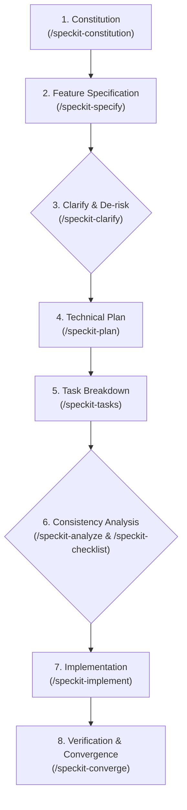

# GitHub Spec Kit (Spec-Driven Development - SDD)

Master orchestration skill for GitHub Spec Kit. This skill governs the Spec-Driven Development (SDD) lifecycle to transform vague ideas or requirements into rigorously specified, verified, and implemented software.

## The Spec-Driven Development Lifecycle



## Available Sub-Skills & Commands

| Stage | Skill / Command | Purpose |
|---|---|---|
| **Constitution** | `/speckit-constitution` | Establish project non-negotiables, architecture rules, and engineering principles (`.specify/memory/constitution.md`). |
| **Specify** | `/speckit-specify <description>` | Convert natural language requirements into structured feature specification (`specs/NNN-<feature>/spec.md`). |
| **Clarify** | `/speckit-clarify` | Identify ambiguities, probe edge cases, and eliminate unstated assumptions before technical planning. |
| **Plan** | `/speckit-plan` | Generate technical architecture, data model, APIs, and implementation strategy (`specs/NNN-<feature>/plan.md`). |
| **Tasks** | `/speckit-tasks` | Generate actionable, dependency-ordered, atomic tasks checklist (`specs/NNN-<feature>/tasks.md`). |
| **Analyze** | `/speckit-analyze` | Audit cross-artifact consistency across spec, plan, tasks, and codebase. |
| **Checklist** | `/speckit-checklist` | Create quality validation checklists for testing and acceptance. |
| **Implement** | `/speckit-implement` | Execute tasks in phased, test-driven order with quality gates. |
| **Converge** | `/speckit-converge` | Audit actual codebase vs spec/plan and append remaining cleanup or remediation tasks. |

## Quickstart / Bootstrap

If the current project workspace does not yet have a `.specify/` folder:
1. Run initialization via PowerShell:
   ```powershell
   specify init --here --force --integration agy --non-interactive --script ps
   ```
2. Or use the bundled templates and scripts located in this skill's directory.

## Best Practices
- Never jump straight into code implementation without an approved specification and task breakdown.
- Keep each task atomic, verifiable, and tied back to a specific requirement in `spec.md`.
- Combine with **EGM (Elephant-Goldfish Model)** (`/egm-review` or `/egm-review-loop`) to conduct independent adversarial review on the drafted spec or architecture plan before implementing.
